# Credit risk project

The firm wants more revenue from accepted accounts. It will not accept a book whose realized default rate is above 10%. Default means the account did not pay as agreed, so that account’s interest and spend revenue for the year is zero. The model ranks each application by probability of default. An account is accepted only when its probability is below the cutoff. A probability equal to the cutoff is rejected.

The cutoff is a prediction. The default rate is what happened afterward. A cutoff of 0.32 does not mean that 32% of accepted accounts defaulted.

We sell the XGBoost model and the conservative strategy, threshold 0.32.

On the train sample the aggressive book, threshold 0.54, stays just under 10% and earns more. On Test 1 its default rate is 10.90%. On Test 2 it is 11.00%. The conservative book stays near 6% on both held-out samples, inside the firm’s limit. The 5% line was our tighter target while searching the train sample. The 10% line is the firm’s.

Revenue is in the units of the anonymized features. It is not dollars and it is not profit. It does not subtract credit losses or operating costs.

The sections below follow the 17-part order of the assignment. Counts use thousands separators. Rates use two decimals. AUC and other small scores use three decimals, as already printed in `presentation/`. No figure below was recomputed for this file.

## How the sources fit

When a number, a rate, an AUC, a revenue, a feature name, or a chart is stated here, it comes from the numbered files in `presentation/`. The claim for each part comes from `presentation/00_slide_guide.md`. Definitions of default, threshold, revenue, and the 5% versus 10% caps come from `strategy/part15.md`. Which object the assignment requires (table, code, chart, workbook) comes from `Credit Risk Project.pdf` and `Credit Risk Project.docx`. The example counts printed inside the assignment’s sample tables are not our results.

`results/` and `strategy/chosen_strategies.csv` keep the unrounded fits those presentation tables were built from. The tables in this file copy the presentation figures.

`strategy/part15.md` chooses both thresholds on the train sample and, on that sample, both books are inside the 10% limit. `presentation/01_strategy_results.csv` is the same two books on train, Test 1, and Test 2. The train row matches. The held-out rows are the reason the recommendation is 0.32.

## 1. The book that still holds

The firm can say yes more often until defaults wipe out the revenue and break a 10% limit. We recommend the book that still holds on accounts the model has not seen.

`presentation/01_recommendation.txt`:

> Recommend the conservative strategy. The aggressive book stays within 10% on the train sample, but it exceeds 10% on a held-out sample. The conservative book is the one that keeps the firm's limit.

| Strategy | Threshold | Train accepted | Train default rate | Train revenue | Test 1 accepted | Test 1 default rate | Test 1 revenue | Test 2 accepted | Test 2 default rate | Test 2 revenue |
| --- | --- | ---: | ---: | ---: | ---: | ---: | ---: | ---: | ---: | ---: |
| Conservative | 0.32 | 42,729 | 4.87% | 541.72 | 9,159 | 5.80% | 115.12 | 9,161 | 5.95% | 114.28 |
| Aggressive | 0.54 | 49,207 | 9.86% | 766.53 | 10,566 | 10.90% | 162.03 | 10,584 | 11.00% | 161.14 |

Source: `presentation/01_strategy_results.csv`.

## 2. The book we learned from

The development sample is 91,783 accounts, a 20% draw of accounts, default rate 25.65%. Each account is scored at its latest statement. In this file that month is March 2018 for every training account, so the six-month window used here is October 2017 through March 2018. The brief calls this the April 2018 vintage and names November 2017 through April 2018. April 2018 is not in the file. We use the month the file actually contains.

A full 13-month history is the healthier book: 77,348 accounts, default rate 22.94%. Shorter histories default at roughly 31% to 47%. We kept them. Dropping them would remove the applicants the model most needs to recognize.

| History | Accounts | Default rate |
| --- | ---: | ---: |
| All applications | 91,783 | 25.65% |
| 13 months | 77,348 | 22.94% |
| 12 months | 2,115 | 37.87% |
| 11 months | 1,159 | 44.09% |
| 10 months | 1,329 | 46.58% |
| 9 months | 1,278 | 43.58% |
| 8 months | 1,169 | 45.08% |
| 7 months | 1,046 | 41.49% |
| 6 months | 1,109 | 41.30% |
| 5 months | 933 | 39.44% |
| 4 months | 938 | 43.07% |
| 3 months | 1,158 | 35.75% |
| 2 months | 1,217 | 31.22% |
| 1 month | 984 | 33.13% |

Source: `presentation/02_history_length.csv`.

The split is 70% train, 15% Test 1, 15% Test 2, stratified on default, seed 42. Train has 64,248 accounts. Test 1 has 13,767. Test 2 has 13,768. The split is at the account level.

The raw file is the American Express Default Prediction competition data. `data/train_labels.csv` is one row per account. `data/train_data.csv` is one row per monthly statement, about 15 GB. It was used to build `samples/development_sample.csv` and then removed. See `data/DATA.md` and `data/train_data.txt`. `scripts/part4.py` draws exactly 10% of the `train_data` columns, always keeping `customer_ID` and `S_2`, then a random 20% of accounts, seed 42, and keeps every statement for those accounts.

## 3. What we could see

The draw has 17 raw fields: Delinquency 10, Spend 1, Payment 0, Balance 4, Risk 2. Payment was on the category list and contributed no field. Spend is `S_27`. The statement date was used to build history and is not one of the 17 predictors.

| Category | Features |
| --- | ---: |
| Delinquency | 10 |
| Spend | 1 |
| Payment | 0 |
| Balance | 4 |
| Risk | 2 |

| Raw feature | Category |
| --- | --- |
| B_12 | Balance |
| B_28 | Balance |
| B_32 | Balance |
| B_37 | Balance |
| D_102 | Delinquency |
| D_104 | Delinquency |
| D_110 | Delinquency |
| D_135 | Delinquency |
| D_136 | Delinquency |
| D_143 | Delinquency |
| D_46 | Delinquency |
| D_48 | Delinquency |
| D_76 | Delinquency |
| D_94 | Delinquency |
| R_13 | Risk |
| R_28 | Risk |
| S_27 | Spend |

Sources: `presentation/03_raw_feature_categories.csv`, `presentation/03_raw_features.csv`.

## 4. How 13 months became account-level signals

Each raw field became an average, sum, minimum, maximum, and median over 3, 6, 9, and 12 months, plus the latest value and the year-over-year change. That is 17 × 22 = 374 summaries. A window is anchored on each account’s own latest statement month. An account whose history is shorter still uses every month it has inside that window. A summary is missing when every value in its window is missing. A year-over-year change is missing when the year-ago statement is absent or its value is zero.

| Category | Engineered features | Selected for modeling |
| --- | ---: | ---: |
| Delinquency | 220 | 23 |
| Spend | 22 | 1 |
| Payment | 0 | 0 |
| Balance | 88 | 8 |
| Risk | 44 | 4 |

| Statistic | Engineered features | Selected for modeling |
| --- | ---: | ---: |
| Average | 68 | 9 |
| Sum | 68 | 2 |
| Minimum | 68 | 4 |
| Maximum | 68 | 7 |
| Median | 68 | 8 |
| Latest | 17 | 4 |
| Year over year | 17 | 2 |

The top five attributes below are the ones later ranked most important. Statistics are on Test 2.

| Feature | Min | 1st | 5th | Median | 95th | 99th | Max | Mean | Missing |
| --- | ---: | ---: | ---: | ---: | ---: | ---: | ---: | ---: | ---: |
| D_48_Latest | -0.009 | 0.001 | 0.013 | 0.310 | 0.955 | 1.05 | 1.98 | 0.406 | 12.46% |
| B_37_Latest | -0.473 | 0.000 | 0.002 | 0.033 | 0.656 | 1.07 | 1.33 | 0.136 | 0.00% |
| B_28_YoY | -1.000 | -0.927 | -0.742 | 0.133 | 5.33 | 23.82 | 2,151.49 | 1.74 | 13.69% |
| D_48_Ave_12 | -0.009 | 0.006 | 0.021 | 0.283 | 0.910 | 0.976 | 1.94 | 0.371 | 6.71% |
| D_48_Ave_3 | -0.010 | 0.003 | 0.016 | 0.292 | 0.946 | 1.02 | 1.97 | 0.393 | 9.32% |

`B_28_YoY` has a very long right tail. That is why its max is in the thousands while its median is 0.133.

Sources: `presentation/04_engineered_feature_categories.csv`, `presentation/04_statistic_types.csv`, `presentation/04_top5_feature_statistics.csv`. Built by `scripts/part6.py` into `samples/account_features.csv`.

## 5. One-hot encoding created zero columns

The brief names 11 categorical fields. None of them are in the 17 raw fields, so one-hot encoding created zero columns. Encoding was run. It created nothing because those fields were not in this draw. There is no `scripts/part5.py`. The result is recorded here.

| Categorical variable | In the development sample | One-hot columns created |
| --- | --- | ---: |
| B_30 | No | 0 |
| B_38 | No | 0 |
| D_63 | No | 0 |
| D_64 | No | 0 |
| D_66 | No | 0 |
| D_68 | No | 0 |
| D_114 | No | 0 |
| D_116 | No | 0 |
| D_117 | No | 0 |
| D_120 | No | 0 |
| D_126 | No | 0 |

```python
# The 11 categorical fields named in the brief.
categorical = [
    "B_30", "B_38", "D_63", "D_64", "D_66", "D_68",
    "D_114", "D_116", "D_117", "D_120", "D_126",
]

# The development sample drew 17 numeric fields. None of the 11 are among them.
present = [name for name in categorical if name in frame.columns]

# One-hot encoding turns each category into its own 0/1 column.
# With no categorical field in the sample, this adds no columns.
encoded = pd.get_dummies(frame[present], dtype="int")
```

Sources: `presentation/05_categorical_treatment.csv`, `presentation/05_one_hot_code.py`.

## 6. Which signals were strong enough to keep

Two XGBoost models scored all 374 summaries on train. Importance is gain, and the shares add to 100%. A feature is kept when either model gives it more than 0.5%. Missing values stay missing. XGBoost sends them down the split direction it learned for them.

The default-settings model kept 28. The specified model (300 trees, learning rate 0.50, depth 4, half the rows, half the columns, default weight 5) kept 14. Six features cleared 0.5% in both. The union is 36. Six raw fields contributed nothing above the cutoff: `B_32`, `D_46`, `D_94`, `D_104`, `D_143`, and `R_28`.

The six features above 0.5% in both models, from `results/03_selected_features.csv`, are `B_37_Latest`, `B_37_Min_3`, `B_37_Med_3`, `D_48_Ave_12`, `B_12_Latest`, and `D_110_Sum_12`.

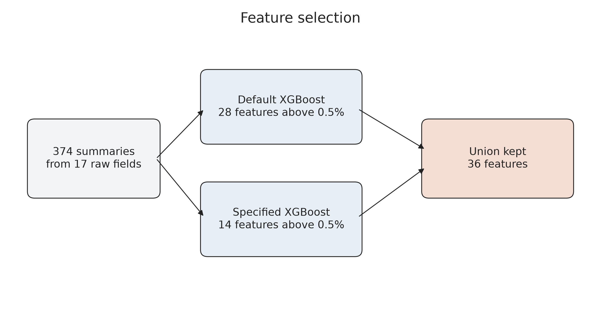

`presentation/06_feature_importance.xlsx` has one sheet per model and a third sheet for the 36 kept features. The picture is the summary. The workbook is the attachment. The same 36 names, later ranked on Test 2, are in section 10. Built by `scripts/part8.py`.

## 7. A short tree model beat a heavier one

Seventy-two models. Each one was fit on train only, then scored on train, Test 1, and Test 2. Tree depth stayed at XGBoost’s own default because it was not one of the dials. Seed 42 fixes the row and feature draws. The results were saved after every model.

| Setting | Values | Why this setting is in the search |
| --- | --- | --- |
| Trees | 50, 100, 300 | Extra trees can fit the train sample more tightly. These three counts show whether that extra fit still helps on Test 2. |
| Learning rate | 0.01, 0.10 | A smaller step changes each tree less. A larger step moves faster and can leave the train score far above the test score. |
| Accounts per tree | 50%, 80% | Each tree then sees a different slice of accounts, so one unusual account does not set every split. |
| Features per tree | 50%, 100% | A 50% draw makes neighboring trees use different features. A 100% draw lets every tree see the full list. |
| Weight of a default | 1, 5, 10 | Defaults are 25.65% of the sample. A heavier default pushes the trees to catch more of them. |

Raising the learning rate to 0.10 lifts train AUC faster than Test 2 AUC. A default weight of 5 or 10 did not win. The winning setting is 50 trees, learning rate 0.10, half the accounts, all of the features, default weight 1.

```python
# 3 x 2 x 2 x 2 x 3 = 72 models. Each model is fit on train only.
TREE_COUNTS = (50, 100, 300)
LEARNING_RATES = (0.01, 0.1)
ROW_SHARES = (50, 80)       # percent of accounts in each tree
FEATURE_SHARES = (50, 100)  # percent of features in each tree
DEFAULT_WEIGHTS = (1, 5, 10)

for n_trees in TREE_COUNTS:
    for learning_rate in LEARNING_RATES:
        for row_share in ROW_SHARES:
            for feature_share in FEATURE_SHARES:
                for weight in DEFAULT_WEIGHTS:
                    model = XGBClassifier(
                        n_estimators=n_trees,
                        learning_rate=learning_rate,
                        subsample=row_share / 100,
                        colsample_bytree=feature_share / 100,
                        scale_pos_weight=weight,
                        random_state=42,
                    )
                    model.fit(X_train, y_train)
                    # AUC is recorded on train, Test 1, and Test 2.
```

Sources: `presentation/07_xgb_grid_settings.csv`, `presentation/07_xgb_grid_code.py`. The full grid is `results/04_xgb_grid_search.csv`, written by `scripts/part9.py`.

## 8. The orange point is the XGBoost model we keep

The selection rule, inside this grid and again between the two finalists, is the average of the three AUCs minus the spread of those three.

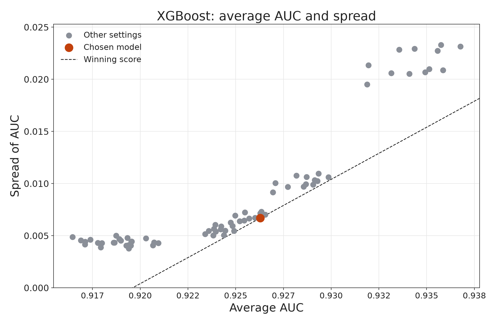

Average versus spread. The orange point is the model we keep: 50 trees, learning rate 0.10, 50% of accounts, 100% of features, default weight 1. It has the highest average AUC minus the spread of the three AUCs. Models farther right fit better on average. Models higher up disagree more across train, Test 1, and Test 2. The dashed line is the winning score. Every other model sits above that line.

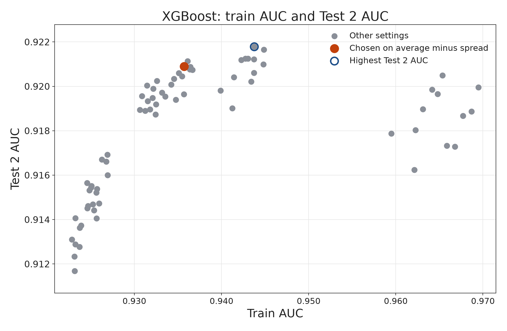

Train versus Test 2. The open blue point has the highest Test 2 AUC: 100 trees, learning rate 0.10, 80% of accounts, 50% of features, default weight 1. Its Test 2 AUC is 0.922 and its train AUC is 0.944. The orange point gives up a little Test 2 AUC and keeps a much smaller gap between train and Test 2. The first plot is the one that chooses the model, because a high Test 2 score that only appears after a large train score is a less stable choice.

The average-minus-spread plot chooses the orange point. The train-versus-Test 2 plot would choose the open blue point. We keep the orange point.

Sources: `presentation/08_scatter_choice.txt`, `presentation/08_xgb_mean_vs_spread.png`, `presentation/08_xgb_train_vs_test2.png`. The same pair is also `results/08_xgb_bias_variance.png`. Chosen by `scripts/part10.py` and saved as `results/07_xgb_final_model.json`.

## 9. The final XGBoost model sorts risk

| Item | Value |
| --- | --- |
| Trees | 50 |
| Learning rate | 0.10 |
| Accounts per tree | 50% |
| Features per tree | 100% |
| Weight of a default | 1 |
| Train AUC | 0.936 |
| Test 1 AUC | 0.922 |
| Test 2 AUC | 0.921 |
| Average AUC | 0.926 |
| Spread of AUC | 0.007 |
| Selection score | 0.920 |

Rank-order bins are cut on the train scores and applied unchanged to both test samples. The actual default rate rises from about 0.1% in the safest bin to about 90% in the riskiest bin, on all three samples. The two safest bins on Test 1 are nearly tied, at 0.37% and 0.35%. From there the bars step up.

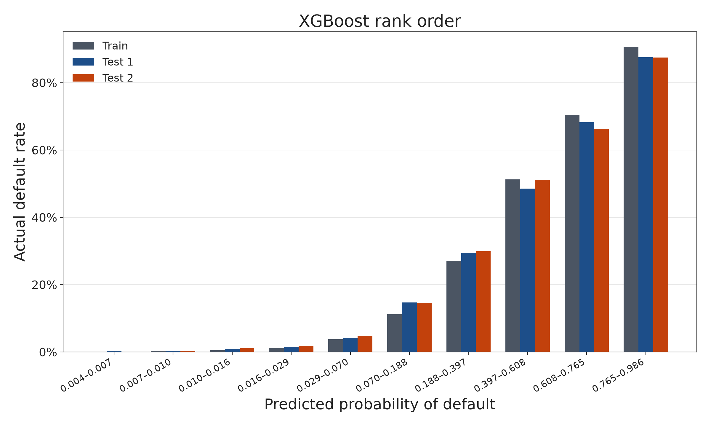

| Sample | Bin | Score interval | Accounts | Default rate |
| --- | ---: | --- | ---: | ---: |
| Train | 1 | 0.004–0.007 | 6,425 | 0.11% |
| Train | 2 | 0.007–0.010 | 6,425 | 0.33% |
| Train | 3 | 0.010–0.016 | 6,425 | 0.53% |
| Train | 4 | 0.016–0.029 | 6,424 | 1.15% |
| Train | 5 | 0.029–0.070 | 6,425 | 3.75% |
| Train | 6 | 0.070–0.188 | 6,425 | 11.18% |
| Train | 7 | 0.188–0.397 | 6,424 | 27.13% |
| Train | 8 | 0.397–0.608 | 6,425 | 51.30% |
| Train | 9 | 0.608–0.765 | 6,425 | 70.40% |
| Train | 10 | 0.765–0.986 | 6,425 | 90.63% |
| Test 1 | 1 | 0.004–0.007 | 1,343 | 0.37% |
| Test 1 | 2 | 0.007–0.010 | 1,423 | 0.35% |
| Test 1 | 3 | 0.010–0.016 | 1,392 | 0.93% |
| Test 1 | 4 | 0.016–0.029 | 1,371 | 1.46% |
| Test 1 | 5 | 0.029–0.070 | 1,325 | 4.23% |
| Test 1 | 6 | 0.070–0.188 | 1,411 | 14.67% |
| Test 1 | 7 | 0.188–0.397 | 1,392 | 29.45% |
| Test 1 | 8 | 0.397–0.608 | 1,342 | 48.58% |
| Test 1 | 9 | 0.608–0.765 | 1,354 | 68.32% |
| Test 1 | 10 | 0.765–0.986 | 1,414 | 87.55% |
| Test 2 | 1 | 0.004–0.007 | 1,361 | 0.07% |
| Test 2 | 2 | 0.007–0.010 | 1,362 | 0.22% |
| Test 2 | 3 | 0.010–0.016 | 1,306 | 1.15% |
| Test 2 | 4 | 0.016–0.029 | 1,415 | 1.84% |
| Test 2 | 5 | 0.029–0.070 | 1,420 | 4.79% |
| Test 2 | 6 | 0.070–0.188 | 1,404 | 14.60% |
| Test 2 | 7 | 0.188–0.397 | 1,406 | 29.94% |
| Test 2 | 8 | 0.397–0.608 | 1,382 | 51.09% |
| Test 2 | 9 | 0.608–0.765 | 1,342 | 66.24% |
| Test 2 | 10 | 0.765–0.986 | 1,369 | 87.51% |

Sources: `presentation/09_xgb_final_model.csv`, `presentation/09_xgb_rank_order.csv`.

## 10. What moves an XGBoost score

SHAP beeswarm is Test 2, all 13,768 accounts. A point to the right of zero pushes that account toward default. Red is a high feature value and blue is a low one.

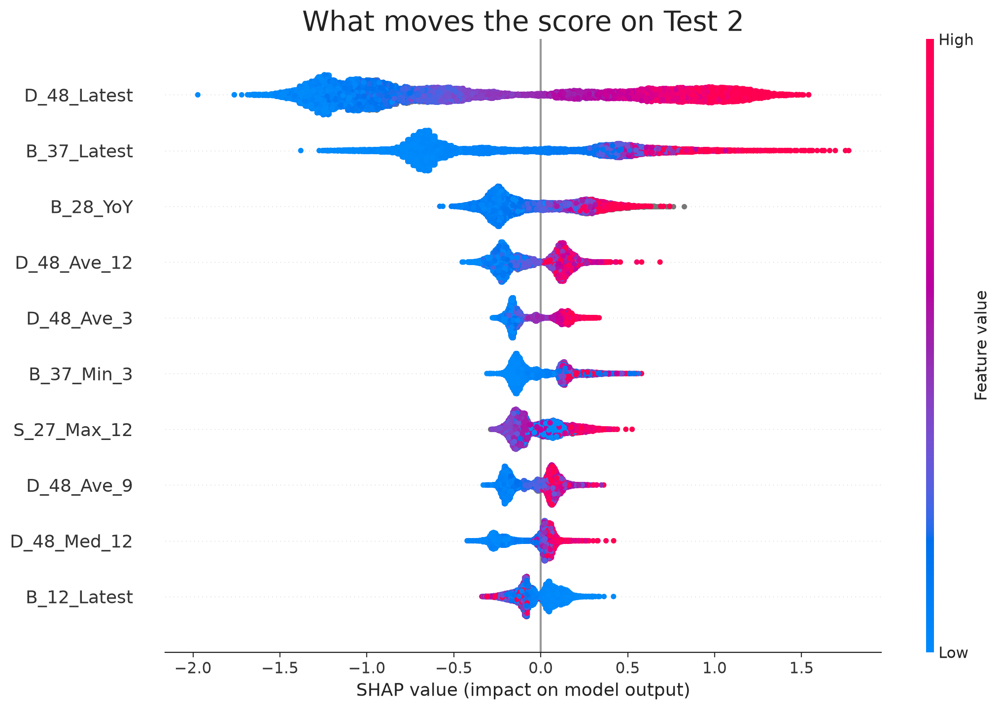

`D_48_Latest` is first. A high latest delinquency value pushes the score up, and a low value pushes it down. `B_37_Latest` is second and has the same direction. `B_28_YoY` is third. The top five mean absolute SHAP values are 0.888, 0.576, 0.234, 0.171, and 0.145.

| Rank | Feature | Mean absolute SHAP |
| ---: | --- | ---: |
| 1 | D_48_Latest | 0.888 |
| 2 | B_37_Latest | 0.576 |
| 3 | B_28_YoY | 0.234 |
| 4 | D_48_Ave_12 | 0.171 |
| 5 | D_48_Ave_3 | 0.145 |
| 6 | B_37_Min_3 | 0.137 |
| 7 | S_27_Max_12 | 0.122 |
| 8 | D_48_Ave_9 | 0.118 |
| 9 | D_48_Med_12 | 0.108 |
| 10 | B_12_Latest | 0.097 |
| 11 | D_102_YoY | 0.080 |
| 12 | B_37_Ave_12 | 0.079 |
| 13 | D_48_Med_9 | 0.074 |
| 14 | B_37_Med_3 | 0.068 |
| 15 | R_13_Max_12 | 0.067 |
| 16 | R_13_Max_9 | 0.061 |
| 17 | B_12_Med_3 | 0.054 |
| 18 | R_13_Max_6 | 0.053 |
| 19 | B_37_Med_9 | 0.044 |
| 20 | D_76_Max_12 | 0.044 |
| 21 | D_136_Med_12 | 0.027 |
| 22 | D_48_Max_3 | 0.026 |
| 23 | D_76_Med_9 | 0.024 |
| 24 | D_136_Min_12 | 0.020 |
| 25 | R_13_Ave_6 | 0.018 |
| 26 | D_48_Med_3 | 0.017 |
| 27 | D_110_Sum_12 | 0.012 |
| 28 | D_76_Sum_3 | 0.010 |
| 29 | D_76_Min_9 | 0.010 |
| 30 | D_135_Max_3 | 0.009 |
| 31 | D_76_Ave_9 | 0.008 |
| 32 | D_135_Ave_6 | 0.008 |
| 33 | D_76_Latest | 0.006 |
| 34 | D_110_Min_9 | 0.006 |
| 35 | D_136_Ave_6 | 0.005 |
| 36 | D_110_Ave_3 | 0.003 |

Source: `presentation/10_xgb_shap_ranking.csv`.

## 11. One score, opened

One Test 2 account, predicted probability 0.430, and it did not default. It sits between 0.32 and 0.54, so only the aggressive strategy would accept it. The chart is on the model’s raw score. The average raw score is −1.105, about the 25.65% base rate. This account ends at −0.281, which is probability 0.43.

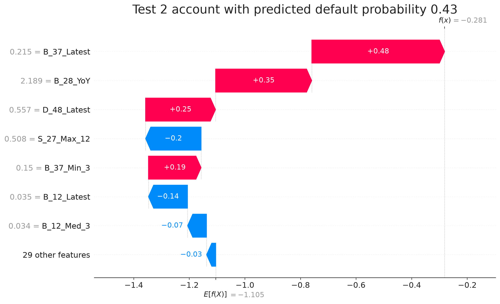

`B_37_Latest` = 0.215 is the largest push toward default, +0.48. The year-over-year balance change and the latest delinquency value push the same way. `S_27_Max_12` = 0.508 pulls the score down by 0.20. To improve this score, the account would need a lower latest balance and a lower latest delinquency value.

The waterfall file prints the same contributions at three decimals. The +0.48 and 0.20 above are the slide figures for 0.478 and −0.200.

| Feature | SHAP value | Feature value |
| --- | ---: | ---: |
| B_37_Latest | 0.478 | 0.215 |
| B_28_YoY | 0.346 | 2.19 |
| D_48_Latest | 0.252 | 0.557 |
| S_27_Max_12 | -0.200 | 0.508 |
| B_37_Min_3 | 0.190 | 0.150 |
| B_12_Latest | -0.141 | 0.035 |
| B_12_Med_3 | -0.068 | 0.034 |
| R_13_Max_12 | -0.061 | 0.009 |

Source: `presentation/11_xgb_shap_observation.csv`. Target 0, probability 0.430.

## 12. The same 36 signals, prepared for a neural net

The neural net uses the same 36 features and no new one-hot columns. Fences and scale are learned on train only. Three steps, in this order:

1. Cap each feature at the train 1st and 99th percentiles of the values that are actually present. Empty cells do not set the fence.
2. Subtract the train average and divide by the train spread. Empty cells are skipped and stay empty.
3. Fill the remaining empty cells with 0. After the scaling, 0 is the train average.

| Feature | Missing | 1st percentile | 99th percentile | Train mean | Train scale |
| --- | ---: | ---: | ---: | ---: | ---: |
| B_37_Latest | 0.00% | 0.000 | 1.08 | 0.136 | 0.223 |
| D_110_Sum_12 | 99.11% | 0.173 | 12.07 | 5.69 | 3.63 |
| S_27_Max_12 | 14.82% | 0.003 | 3.46 | 0.469 | 0.467 |

`B_37_Latest` is complete, so its train scale is the real spread, 0.223. `D_110_Sum_12` is missing on 99.11% of train accounts. Its observed 1st percentile is 0.173 and its 99th is 12.07, so the cap still has a range. Filling with zero before the cap would have crushed that feature.

Sources: `presentation/12_nn_processing_steps.csv`, `presentation/12_nn_processing_examples.csv`. The fences for all 36 features are in `results/09_nn_processing.csv`. Prepared samples are `samples/nn_train.csv`, `samples/nn_test1.csv`, and `samples/nn_test2.csv`, written by `scripts/part11.py`.

## 13. A small net beat a larger one

Thirty-two models. Two layers and four layers are separate loops. Dropout of 100% means the dropout layer is left out, so every node is kept. It does not mean `Dropout(1.0)`. Adam, binary cross-entropy, and 20 epochs stay fixed. Seed 42 is reset before each model. Batch size 100 beat batch size 10,000. Keeping every node beat dropping half of them. One setting — 4 layers, 6 ReLU nodes, 50% dropout, batch 10,000 — scored below 0.50 on all three samples. The winner is 2 layers, 6 ReLU nodes, no dropout, batch 100.

| Setting | Values | Why this setting is in the search |
| --- | --- | --- |
| Hidden layers | 2, 4 | Two layers can combine the 36 features. Four layers can combine those combinations. The two shapes are trained in separate loops. |
| Nodes per layer | 4, 6 | More nodes give the layer more room to fit a pattern. Four and six stay small relative to 64,248 training accounts. |
| Activation | ReLU, tanh | ReLU passes a positive signal through. Tanh squashes every signal into a range from −1 to 1. |
| Dropout | 50%, none | Dropping half the nodes on each update keeps the net from depending on one node. Keeping every node shows what that protection costs in accuracy. |
| Batch size | 100, 10,000 | A batch of 100 updates the weights often. A batch of 10,000 updates them on a much larger slice of the sample. |
| Fixed | Adam / 20 epochs / binary cross-entropy | These do not change across the 32 models so the search measures the five settings above. |

```python
# 2 x 2 x 2 x 2 x 2 = 32 models. The layer counts use separate loops.
# Dropout of 100% means every node is kept. Dropout of 50% drops half the nodes.
for n_layers in (2, 4):
    for n_nodes in (4, 6):
        for activation in ("relu", "tanh"):
            for dropout_pct in (50, 100):
                for batch_size in (100, 10000):
                    network = keras.Sequential()
                    network.add(keras.Input(shape=(36,)))
                    for _ in range(n_layers):
                        network.add(keras.layers.Dense(n_nodes, activation=activation))
                        if dropout_pct == 50:
                            network.add(keras.layers.Dropout(0.5, seed=42))
                    network.add(keras.layers.Dense(1, activation="sigmoid"))
                    network.compile(optimizer="adam", loss="binary_crossentropy")
                    network.fit(X_train, y_train, epochs=20, batch_size=batch_size, shuffle=True)
                    # AUC is recorded on train, Test 1, and Test 2.
```

Sources: `presentation/13_nn_grid_settings.csv`, `presentation/13_nn_grid_code.py`. The full grid is `results/10_nn_grid_search.csv`, written by `scripts/part12.py`.

## 14. Both plots choose the same neural net

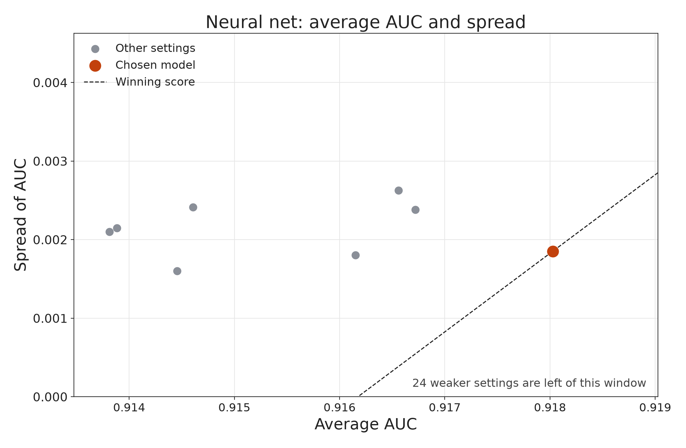

Average versus spread. The window shows the strongest settings. Twenty-four weaker settings sit to the left of it. The orange point is the only one on the winning-score line: 2 hidden layers, 6 nodes, ReLU, no dropout, batch size 100.

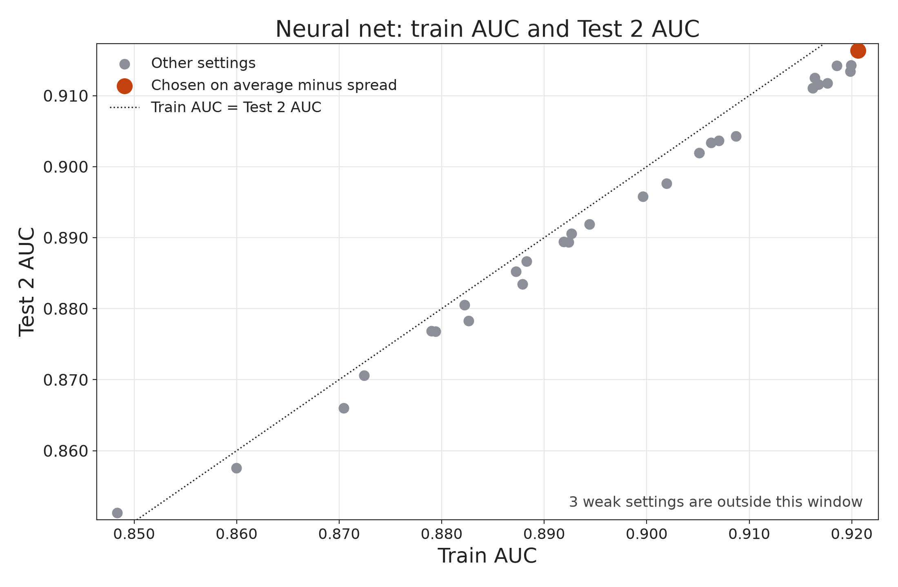

Train versus Test 2. The same orange point is also the highest Test 2 AUC, 0.916. On this plot the two rules agree. Three weak settings, including one with AUC below 0.50, are outside the window. The points hug the equality line, so the neural net’s train score and Test 2 score stay close together.

Sources: `presentation/14_scatter_choice.txt`. The unzoomed pair is `results/15_nn_bias_variance.png`. The saved model is `results/13_nn_final_model.keras`, written by `scripts/part13.py`.

## 15. The final neural net also rank-orders

| Item | Value |
| --- | --- |
| Hidden layers | 2 |
| Nodes in each layer | 6 |
| Activation | ReLU |
| Dropout | None |
| Batch size | 100 |
| Epochs | 20 |
| Optimizer | Adam |
| Loss | Binary cross-entropy |
| Train AUC | 0.921 |
| Test 1 AUC | 0.917 |
| Test 2 AUC | 0.916 |
| Average AUC | 0.918 |
| Spread of AUC | 0.002 |
| Selection score | 0.916 |

The bins are cut on the train probabilities and applied to both test samples. The default rate rises from well under 1% in the safest bin to about 87% in the riskiest bin, on all three samples.

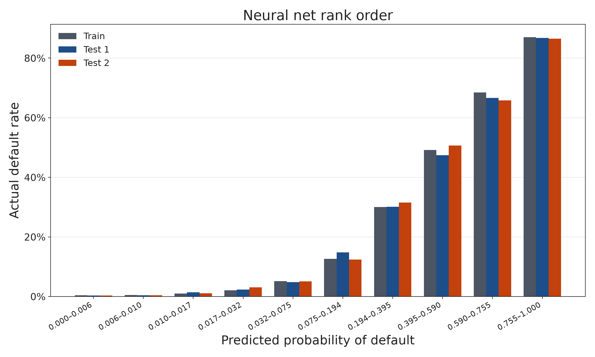

| Sample | Bin | Score interval | Accounts | Default rate |
| --- | ---: | --- | ---: | ---: |
| Train | 1 | 0.000–0.006 | 6,425 | 0.44% |
| Train | 2 | 0.006–0.010 | 6,425 | 0.53% |
| Train | 3 | 0.010–0.017 | 6,425 | 1.01% |
| Train | 4 | 0.017–0.032 | 6,424 | 2.09% |
| Train | 5 | 0.032–0.075 | 6,425 | 5.17% |
| Train | 6 | 0.075–0.194 | 6,425 | 12.61% |
| Train | 7 | 0.194–0.395 | 6,424 | 30.04% |
| Train | 8 | 0.395–0.590 | 6,425 | 49.18% |
| Train | 9 | 0.590–0.755 | 6,425 | 68.44% |
| Train | 10 | 0.755–1.000 | 6,425 | 87.00% |
| Test 1 | 1 | 0.000–0.006 | 1,361 | 0.37% |
| Test 1 | 2 | 0.006–0.010 | 1,404 | 0.43% |
| Test 1 | 3 | 0.010–0.017 | 1,408 | 1.42% |
| Test 1 | 4 | 0.017–0.032 | 1,356 | 2.36% |
| Test 1 | 5 | 0.032–0.075 | 1,339 | 4.85% |
| Test 1 | 6 | 0.075–0.194 | 1,397 | 14.82% |
| Test 1 | 7 | 0.194–0.395 | 1,355 | 30.11% |
| Test 1 | 8 | 0.395–0.590 | 1,345 | 47.43% |
| Test 1 | 9 | 0.590–0.755 | 1,395 | 66.59% |
| Test 1 | 10 | 0.755–1.000 | 1,406 | 86.77% |
| Test 2 | 1 | 0.000–0.006 | 1,356 | 0.37% |
| Test 2 | 2 | 0.006–0.010 | 1,347 | 0.45% |
| Test 2 | 3 | 0.010–0.017 | 1,405 | 1.07% |
| Test 2 | 4 | 0.017–0.032 | 1,413 | 3.04% |
| Test 2 | 5 | 0.032–0.075 | 1,350 | 5.04% |
| Test 2 | 6 | 0.075–0.194 | 1,384 | 12.36% |
| Test 2 | 7 | 0.194–0.395 | 1,400 | 31.50% |
| Test 2 | 8 | 0.395–0.590 | 1,368 | 50.66% |
| Test 2 | 9 | 0.590–0.755 | 1,378 | 65.82% |
| Test 2 | 10 | 0.755–1.000 | 1,367 | 86.54% |

Sources: `presentation/15_nn_final_model.csv`, `presentation/15_nn_rank_order.csv`.

## 16. The same rule picks XGBoost

| Model | Train AUC | Test 1 AUC | Test 2 AUC | Average AUC | Spread | Selection score | Chosen |
| --- | ---: | ---: | ---: | ---: | ---: | ---: | --- |
| XGBoost | 0.936 | 0.922 | 0.921 | 0.926 | 0.007 | 0.920 | Yes |
| Neural net | 0.921 | 0.917 | 0.916 | 0.918 | 0.002 | 0.916 | No |

The neural net is the tighter model. Its average is lower by about 0.008, and that gap is larger than the extra spread of the XGBoost model. XGBoost wins. Both models rank-order. The strategy uses the XGBoost probabilities.

Source: `presentation/16_final_model_comparison.csv`. Compared by `scripts/part14.py`. The unrounded comparison is `results/14_final_model_comparison.csv`.

## 17. The cutoff is a business choice on top of that score

Return to 0.32, because 0.54 does not keep the 10% limit once the model sees new accounts.

For account \(i\):

| Symbol | Meaning |
| --- | --- |
| \(Y_i\) | Observed default. 1 if the account defaulted, 0 if it did not. |
| \(PD_i\) | Probability of default from the saved XGBoost model. |
| \(B_i\) | Estimated monthly balance, `B_37_Ave_6`. |
| \(S_i\) | Estimated monthly spend, `S_27_Ave_6`. |
| \(t\) | A threshold between 0 and 1. |
| \(t_C\) | Conservative threshold. |
| \(t_A\) | Aggressive threshold. \(t_C < t_A\). |

Accept when \(PD_i < t\). Reject when \(PD_i > t\). Reject when \(PD_i = t\).

\[
DR(t) = \frac{\sum_i Y_i \,\text{Accept}_i(t)}{\sum_i \text{Accept}_i(t)}
\]

If the cutoff accepts nobody, there is no group to measure and \(DR(t)\) is undefined.

Balance is `B_37_Ave_6`. Spend is `S_27_Ave_6`. Missing spend is set to 0 before the function runs. On the train sample that is 11,480 accounts. On Test 1 it is 2,378. On Test 2 it is 2,442. `B_37_Ave_6` is present for every train account. Every train account’s newest statement is March 2018, so those six months are October 2017 through March 2018.

The brief’s dollar example shows the two rates. A customer who spends $1,000 and revolves $800 produces \(1{,}000 \times 0.001 + 800 \times 0.02 = 17\) in a month, and \(12 \times 17 = 204\) in a year. If that customer defaults, the revenue is counted as 0. Our features are not dollars. The same rates are applied to them.

\[
R_i = 12(0.02\, B_i + 0.001\, S_i)\,(1 - Y_i)
\]

The 0.02 is a 24% annual interest rate written monthly. The 0.001 is a 0.1% charge on monthly spend. \((1 - Y_i)\) keeps the revenue when the account did not default and sets it to 0 when it did. Rejected accounts are left out. This is revenue under those two rates.

```python
def portfolio_result(data, target_name, probability_name, balance_name, spend_name, threshold):
    """Default rate and 12-month revenue for accounts with PD below the threshold."""
    accepted = data.loc[data[probability_name] < threshold]
    if len(accepted) == 0:
        return float("nan"), 0.0

    default_rate = float(accepted[target_name].mean())
    monthly = 0.02 * accepted[balance_name] + 0.001 * accepted[spend_name]
    revenue = 12 * monthly
    # A defaulted account stays in the default rate and contributes no revenue.
    revenue = revenue.where(accepted[target_name] == 0, 0.0)
    return default_rate, float(revenue.sum())
```

The function takes, in order: the data table, the target column, the probability column, the balance column, the spend column, and the threshold. For the train book those columns are `target`, `pd`, `monthly_balance`, and `monthly_spend` in `strategy/train_book.csv`. `customer_ID` is stored and is not used in the calculation. The same function is `portfolio_result` in `scripts/part15.py`. The slide copy is `presentation/17_strategy_function.py`.

The search uses the train sample only, at \(t = 0.01, 0.02, \ldots, 0.99\). Revenue on this search rises as the threshold rises, because more non-defaulting accounts are added. Inside a cap, the chosen threshold is the one with the largest revenue.

\[
\begin{aligned}
t_A &= \arg\max Rev(t) \quad \text{on the 0.01 grid, subject to } DR(t) \le 0.10, \\
t_C &= \arg\max Rev(t) \quad \text{on the 0.01 grid, subject to } DR(t) \le 0.05.
\end{aligned}
\]

Those rules select \(t_C = 0.32\) and \(t_A = 0.54\). The 5% line is our choice. The assignment requires only the 10% cap.

| Next grid step | Accepted | Default rate | 12-month revenue | Result |
| --- | ---: | ---: | ---: | --- |
| \(t = 0.33\) | 43,019 | 5.03% | 552.78 | Misses the 5% cap. |
| \(t = 0.55\) | 49,532 | 10.16% | 776.59 | Misses the 10% cap. |

On the train sample:

| Strategy | Threshold | Accepted | Accept rate | Default rate | 12-month revenue | Within 10% |
| --- | ---: | ---: | ---: | ---: | ---: | --- |
| Conservative | 0.32 | 42,729 | 66.51% | 4.87% | 541.72 | Yes |
| Aggressive | 0.54 | 49,207 | 76.59% | 9.86% | 766.53 | Yes |

Moving from the conservative book to the aggressive book, on the train sample, accepts 6,478 more accounts. Revenue rises by 224.81. The default rate rises from 4.87% to 9.86%. Both of those train books meet the firm’s limit. The held-out books do not both meet it. Test 1 and Test 2 for the aggressive book are 10.90% and 11.00%, in the table in section 1.

The default rate changes only when a whole account is added. Sorted from the lowest \(PD\) to the highest, the last train group that still satisfies each cap, and the single account that breaks it, are:

| Cap | Last group inside the cap | Default rate | Revenue | The next account |
| --- | ---: | ---: | ---: | --- |
| 5% | 42,954 accounts | 4.9984% | 550.36 | Default rate becomes 5.0006%. Revenue stays 550.36. |
| 10% | 49,367 accounts | 9.9986% | 771.13 | Default rate becomes 10.0004%. Revenue stays 771.13. |

In both cases the next account defaulted, so it crosses the cap and contributes no revenue. The 0.01 grid stops one step earlier than these last legal groups. The gap is 225 accounts and 8.64 of revenue under the 5% cap, and 160 accounts and 4.60 of revenue under the 10% cap. The reported strategies are the grid choices.

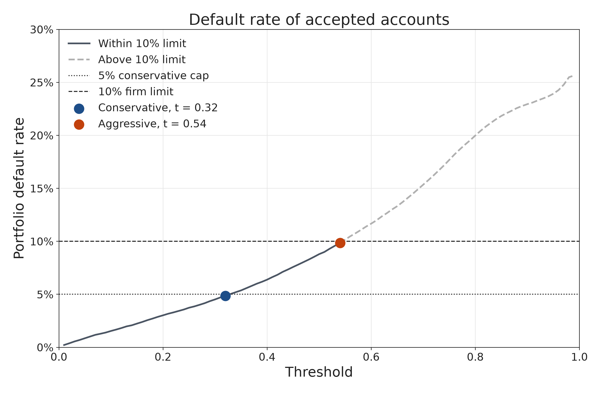

The dotted line is the 5% cap. The dashed horizontal line is the 10% firm limit.

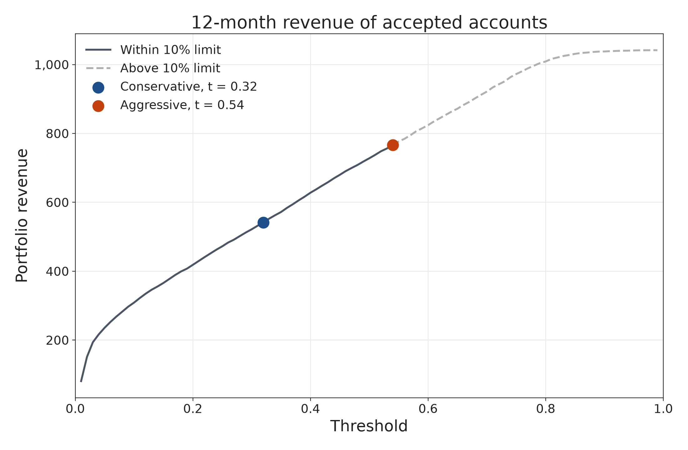

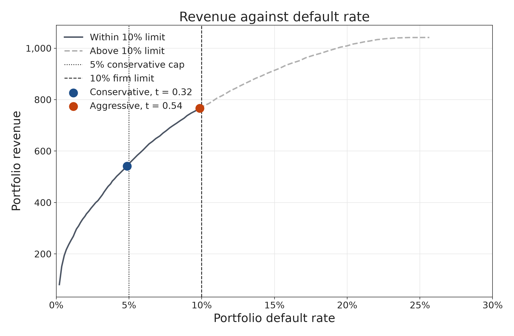

On the train sample, the picture is 224.81 more revenue for a default rate of 9.86% instead of 4.87%, with both train choices inside the 10% limit. The same three figures are in `strategy/`.

The table the brief asks for, evaluated at the same thresholds on all three samples. Thresholds 0.32 and 0.54 sit between these rows.

| Threshold | Train accepted | Train default rate | Train revenue | Test 1 accepted | Test 1 default rate | Test 1 revenue | Test 2 accepted | Test 2 default rate | Test 2 revenue |
| --- | ---: | ---: | ---: | ---: | ---: | ---: | ---: | ---: | ---: |
| 0.1 | 34,488 | 1.54% | 308.78 | 7,346 | 2.12% | 67.01 | 7,345 | 2.16% | 66.46 |
| 0.2 | 39,039 | 3.02% | 418.47 | 8,370 | 3.99% | 90.03 | 8,373 | 4.06% | 90.53 |
| 0.3 | 42,140 | 4.52% | 521.58 | 9,037 | 5.61% | 110.38 | 9,043 | 5.64% | 110.23 |
| 0.4 | 45,076 | 6.38% | 627.83 | 9,683 | 7.51% | 131.80 | 9,697 | 7.69% | 132.91 |
| 0.5 | 48,018 | 8.79% | 727.77 | 10,336 | 9.89% | 155.32 | 10,339 | 10.00% | 154.05 |
| 0.6 | 51,110 | 11.67% | 824.01 | 10,948 | 12.19% | 175.19 | 11,010 | 12.84% | 173.73 |
| 0.7 | 54,807 | 15.35% | 921.50 | 11,707 | 15.66% | 194.95 | 11,747 | 15.84% | 197.32 |
| 0.8 | 59,295 | 19.98% | 1,008.92 | 12,654 | 19.99% | 214.98 | 12,695 | 20.20% | 217.70 |

Source: `presentation/17_strategy_thresholds.csv`. The full 0.01 train search is `strategy/threshold_search.csv`. The two saved choices are `strategy/chosen_strategies.csv`.

The recommendation is the same one this file opened with. Use the XGBoost probabilities. Accept when the probability is below 0.32.

## What is in this folder

| Path | What it holds |
| --- | --- |
| `Credit Risk Project.pdf`, `Credit Risk Project.docx` | The assignment. It says which artifact belongs in which part. |
| `requirements.txt` | Package pins for the project environment. Python 3.13. |
| `data/train_labels.csv` | One default flag per account. |
| `data/DATA.md`, `data/train_data.txt` | Where the 15 GB statement file went, and how to download it again. |
| `samples/development_sample.csv` | Statement-level 20% account draw. |
| `samples/account_features.csv` | One row per account, 374 summaries. |
| `samples/train.csv`, `test1.csv`, `test2.csv` | 64,248 / 13,767 / 13,768. |
| `samples/nn_train.csv`, `nn_test1.csv`, `nn_test2.csv` | The same accounts after the three neural-net steps. |
| `results/01_xgb_default_importance.csv`, `02_xgb_specified_importance.csv` | The two gain screens. |
| `results/03_selected_features.csv` | The 36 kept features and both flags. |
| `results/04_xgb_grid_search.csv`, `05_xgb_grid_bias_variance.csv` | All 72 tree models. |
| `results/06_xgb_final_parameters.csv`, `07_xgb_final_model.json` | The orange-point model. |
| `results/08_xgb_bias_variance.png` | The XGBoost choice plots. |
| `results/09_nn_processing.csv` | Train fences and scales for all 36 features. |
| `results/10_nn_grid_search.csv`, `11_nn_grid_bias_variance.csv` | All 32 nets. |
| `results/12_nn_final_parameters.csv`, `13_nn_final_model.keras` | The winning net. |
| `results/14_final_model_comparison.csv` | Unrounded comparison. XGBoost is chosen. |
| `results/15_nn_bias_variance.png` | The neural-net choice plots. |
| `strategy/part15.md` | Definitions, the train search, and the caveats in section 17. |
| `strategy/train_book.csv` | One row per train account: target, probability, balance, spend. |
| `strategy/threshold_search.csv`, `chosen_strategies.csv` | The 0.01 grid and the two saved thresholds. |
| `strategy/*.png` | The three strategy figures. |
| `presentation/00_slide_guide.md` | The claim for each of the 17 parts. |
| `presentation/00_build_facts.csv` | Checks used while the presentation files were built, including the missing-spend counts. |
| `presentation/01` through `presentation/17` | The numbers, pictures, code, and captions copied above. |
| `presentation/assembly_instructions.md` | The rules this write-up follows: do not recompute, do not relabel a month, do not call the aggressive book acceptable on a new sample. |
| `scripts/part4.py` | Builds the development sample. Needs `data/train_data.csv`. |
| `scripts/part6.py` | Account-level summaries. |
| `scripts/part7.py` | Stratified split, seed 42. |
| `scripts/part8.py` | Two importance screens, union of 36. |
| `scripts/part9.py`, `part10.py` | 72-model search and the saved XGBoost model. |
| `scripts/part11.py`, `part12.py`, `part13.py` | Neural-net preparation, 32-model search, saved net. |
| `scripts/part14.py` | Applies the selection score to the two finalists. |
| `scripts/part15.py` | `portfolio_result` and the train threshold search. |
| `scripts/plot_bias_variance.py`, `plot_strategy.py` | The choice plots and the strategy plots. |
| `scripts/build_presentation.py` | Writes the numbered files in `presentation/`. |

`scripts/part4.py` through `scripts/part15.py` run in that order. Each one reads the previous step’s file. Part 5 is the one-hot step, and it added no columns, so there is no `part5.py`.

Rebuilding `samples/development_sample.csv` needs `train_data.csv` back in `data/`. The download steps are in `data/DATA.md`. Do not commit that file.

```bash
python3 -m venv .venv
source .venv/bin/activate
pip install -r requirements.txt
```

The pins are numpy 2.4.6, pandas 3.0.3, scipy 1.18.0, scikit-learn 1.9.0, matplotlib 3.11.0, seaborn 0.13.2, xgboost 3.4.1, tensorflow 2.21.0, and shap 0.54.1. `scripts/part12.py` imports TensorFlow. `scripts/build_presentation.py` imports SHAP. The comments above those two pins in `requirements.txt` still say no script imports them. The seaborn pin’s comment matches the scripts: none of them import seaborn.
