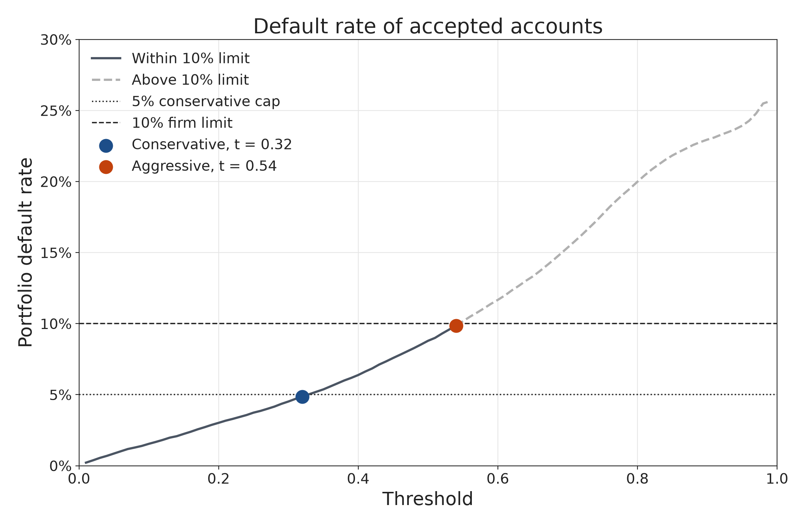
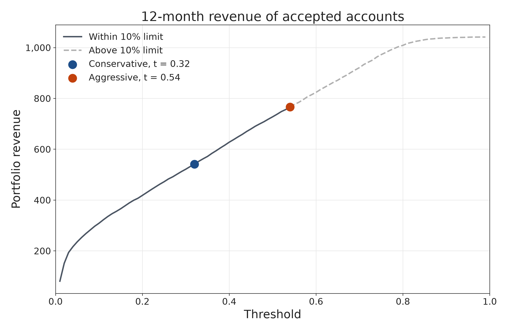
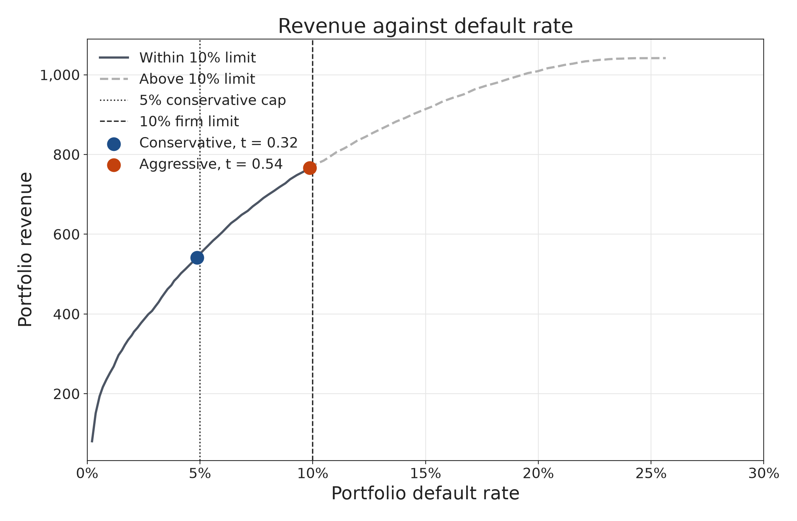

# Strategy: who receives a card

Part 15 turns the saved model into two accept-or-reject rules and estimates what each rule would return.

The model is the XGBoost model chosen in part 14, saved as `results/07_xgb_final_model.json`. It scores each train account with a probability of default, \(PD\). A threshold \(t\) is a cutoff on that score.

- Accept the account when \(PD\) is below \(t\).
- Reject the account when \(PD\) is above \(t\).

An account whose \(PD\) is exactly \(t\) is rejected. The two strategies use the same rule and different cutoffs. The conservative cutoff is lower, so it accepts fewer accounts. The aggressive cutoff is higher, so it accepts more. Both keep the actual default rate of the accepted accounts at or below 10%.

The cutoff is a prediction. The default rate is what happened afterward. A cutoff of 0.15 does not mean that 15% of the accepted customers defaulted.

## Notation

For account \(i\),

| Symbol | Meaning |
| --- | --- |
| \(Y_i\) | Observed default. \(1\) if the account defaulted, \(0\) if it did not. |
| \(PD_i\) | Probability of default from the saved XGBoost model. |
| \(B_i\) | Estimated monthly balance, `B_37_Ave_6`. |
| \(S_i\) | Estimated monthly spend, `S_27_Ave_6`. |
| \(t\) | A threshold between 0 and 1. |
| \(t_C\) | Conservative threshold. |
| \(t_A\) | Aggressive threshold. \(t_C < t_A\). |

\(B_i\) and \(S_i\) are anonymized feature values. The revenue figures below are in those units.

## Default rate

Look only at the accepted accounts, and use the observed outcome \(Y\):

\[
DR(t)
=
\frac{\sum_i Y_i \,\text{Accept}_i(t)}{\sum_i \text{Accept}_i(t)},
\qquad
\text{Accept}_i(t) = 1 \text{ when } PD_i < t.
\]

If the cutoff accepts nobody, there is no group to measure and \(DR(t)\) is undefined.

## Balance, spend, and revenue

The development sample has one spend feature, `S_27`, and the balance feature kept by both importance screens is `B_37`. The brief asks for the average of the last six statement months. Those columns are `S_27_Ave_6` and `B_37_Ave_6`.

Every train account's newest statement is in March 2018, so the six months in those averages are October 2017 through March 2018. The brief names November 2017 through April 2018. April 2018 is not in the file.

`S_27_Ave_6` is missing for 11,480 of the 64,248 train accounts. Those missing values are set to 0: there is no observed spend to charge. `B_37_Ave_6` is present for every train account.

The brief's dollar example shows the rates. A customer who spends $1,000 and revolves $800 produces

\[
1{,}000 \times 0.001 + 800 \times 0.02 = 1 + 16 = 17
\]

dollars in a month, and \(12 \times 17 = 204\) dollars in a year. If that customer defaults, the revenue is counted as 0. Our features are not dollars, but the same rates are applied to them.

Monthly revenue, before the default rule, is

\[
r_i = 0.02\, B_i + 0.001\, S_i.
\]

The 0.02 is a 24% annual interest rate written monthly. The 0.001 is a 0.1% charge on monthly spend. The 12-month amount is wiped out when the account defaults:

\[
R_i = 12(0.02\, B_i + 0.001\, S_i)\,(1 - Y_i).
\]

\((1 - Y_i)\) keeps the revenue when \(Y_i = 0\) and sets it to 0 when \(Y_i = 1\). Rejected accounts are left out:

\[
Rev(t) = \sum_i R_i \,\text{Accept}_i(t).
\]

This is revenue under those two rates. It does not subtract credit losses or operating costs, so it is not profit.

## The function

`portfolio_result` in `scripts/part15.py` takes the six inputs required by the brief and returns the two required outputs.

| Order | Input | What is passed for the train book |
| --- | --- | --- |
| 1 | Data table | `strategy/train_book.csv`. One row per train account. |
| 2 | Target column name | `target`, the column of \(Y_i\). |
| 3 | Probability column name | `pd`, the column of \(PD_i\). |
| 4 | Balance column name | `monthly_balance`, the column of \(B_i\). |
| 5 | Spend column name | `monthly_spend`, the column of \(S_i\). |
| 6 | Threshold | A number \(t\) between 0 and 1. |

The names are arguments, so the function still works if the columns have different names. `customer_ID` is stored in the book for reference and is not used in the calculation.

The function does the following:

1. Keep rows with \(PD < t\).
2. Default rate = accepted accounts with \(Y = 1\), divided by the number accepted.
3. For each accepted account, compute \(12(0.02 B_i + 0.001 S_i)\).
4. Set that amount to 0 when \(Y = 1\).
5. Add those amounts.
6. Return \(\big(DR(t),\; Rev(t)\big)\).

If no row is accepted, the default rate is undefined and the revenue is 0.

## How the thresholds were chosen

The search uses the train sample only. It evaluates

\[
t = 0.01,\; 0.02,\; \ldots,\; 0.99.
\]

The full search is `strategy/threshold_search.csv`. The firm's only constraint is

\[
DR(t) \le 0.10.
\]

Revenue on this search rises as the threshold rises, because more non-defaulting accounts are added. Inside a cap, the chosen threshold is the one with the largest revenue. The aggressive rule uses the firm's cap. The conservative rule uses half of that cap, so the safer book has a round line to stand next to the aggressive one. The 5% line is our choice. The assignment requires only the 10% cap.

\[
\begin{aligned}
t_A &= \arg\max Rev(t) \quad \text{on the 0.01 grid, subject to } DR(t) \le 0.10, \\
t_C &= \arg\max Rev(t) \quad \text{on the 0.01 grid, subject to } DR(t) \le 0.05.
\end{aligned}
\]

Those rules select \(t_C = 0.32\) and \(t_A = 0.54\). The choices are saved in `strategy/chosen_strategies.csv`.

| Next grid step | Accepted | Default rate | 12-month revenue | Result |
| --- | ---: | ---: | ---: | --- |
| \(t = 0.33\) | 43,019 | 5.03% | 552.78 | Misses the 5% cap. |
| \(t = 0.55\) | 49,532 | 10.16% | 776.59 | Misses the 10% cap. |

## Chosen strategies

| Strategy | Symbol | Threshold | Accepted | Accept rate | Default rate | 12-month revenue | Within 10% |
| --- | --- | ---: | ---: | ---: | ---: | ---: | --- |
| Conservative | \(t_C\) | 0.32 | 42,729 | 66.51% | 4.87% | 541.72 | Yes |
| Aggressive | \(t_A\) | 0.54 | 49,207 | 76.59% | 9.86% | 766.53 | Yes |

Moving from the conservative book to the aggressive book accepts 6,478 more accounts. Revenue rises by 224.81. The default rate rises from 4.87% to 9.86%. Both books meet the firm's limit. Management can choose the safer book or the higher-revenue book.

## Why one more account does not help

The default rate changes only when a whole account is added. It cannot be dialed to a number such as 9.999999%.

Sorted from the lowest \(PD\) to the highest, the last group that still satisfies each cap, and the single account that breaks it, are:

| Cap | Last group inside the cap | Default rate | Revenue | The next account |
| --- | ---: | ---: | ---: | --- |
| 5% | 42,954 accounts | 4.9984% | 550.36 | Default rate becomes 5.0006%. Revenue stays 550.36. |
| 10% | 49,367 accounts | 9.9986% | 771.13 | Default rate becomes 10.0004%. Revenue stays 771.13. |

In both cases the next account defaulted, so \((1 - Y_i) = 0\). Adding it crosses the cap and contributes no revenue. That is why the aggressive book stops at the last account still under 10%, and why the step from 0.54 to 0.55 is not a usable strategy: 0.55 accepts 49,532 accounts at a 10.16% default rate.

The 0.01 grid stops one step earlier than these last legal groups. The gap is 225 accounts and 8.64 of revenue under the 5% cap, and 160 accounts and 4.60 of revenue under the 10% cap. The reported strategies are the grid choices in `chosen_strategies.csv`, which are the thresholds drawn on the figures.

## Figures

Default rate of the accepted accounts. The dotted line is the 5% cap. The dashed horizontal line is the 10% firm limit. The dashed curve is the region past that limit.

Twelve-month revenue at the same thresholds. Both chosen points are on the solid part of the curve.

Revenue against the realized default rate. This is the tradeoff for management: 224.81 more revenue for a default rate of 9.86% instead of 4.87%, with both choices inside the 10% limit.

